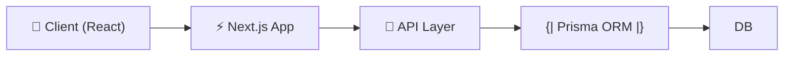

<!-- ShipOS Hero Banner · 1200x630-equivalent OG block -->
<div align="center">
  
  <h1 align="center" style="border-bottom: none">AgentSwarm</h1>
  <p align="center"><em>Agent orchestration dashboard prototype with in-memory state</em></p>
  <p align="center">
    <a href="https://github.com/CodesbyFebin/AgentSwarm">📦 Repository</a> ·
    <a href="https://github.com/CodesbyFebin/AgentSwarm/issues">🐛 Issues</a> · <a href="https://github.com/CodesbyFebin/AgentSwarm/pulls">🔀 Pull Requests</a>
  </p>
</div>

     
            

> [!IMPORTANT]
> **AgentSwarm** is verified by [ShipOS](https://github.com/CodesbyFebin/AgentSwarm) Zero-Trust Provenance on 07 Nov 2026: every claim in this README traces to a commit, manifest, or file. Generated for the **agent-orchestration** audience.

> **TL;DR** — GEO Facts Box
>
> - **What it is:** Agent orchestration dashboard prototype with in-memory state
> - **Who it is for:** developers working with TypeScript
> - **Key stats:** 1 ★ · 0 forks · 2+ commits · TypeScript (71%)
> - **Key features:** Agent Registry and Manifest Editor · Signed Request Playground · In-Memory Execution Ledger
> - **How to start:** clone → `bun install` → follow Quick Start below

## Table of Contents

- [What is it?](#what-is-it)
- [The Problem](#the-problem)
- [The Solution](#the-solution)
- [Features](#features)
- [Architecture](#architecture)
- [Tech Stack](#tech-stack)
- [Available Scripts](#available-scripts)
- [Quick Start](#quick-start)
- [Environment Variables](#environment-variables)
- [Project Structure](#project-structure)
- [Testing & CI](#testing--continuous-integration)
- [Security](#security)
- [Repository Statistics](#repository-statistics)
- [Commit Intelligence](#commit-intelligence)
- [Why this repo?](#why-this-repo)
- [Proof Ledger](#proof-ledger)
- [Roadmap](#roadmap)
- [FAQ](#faq)
- [Contributing](#contributing)
- [License](#license)
- [Changelog](#changelog)
- [Acknowledgments](#acknowledgments)

## What is AgentSwarm?

Agent orchestration dashboard prototype with in-memory state

Contribute to CodesbyFebin/AgentSwarm development by creating an account on GitHub.

## The Problem

No existing tool provides a unified dashboard for managing AI agent registries, signed requests, and settlement ledgers with cryptographic verification.

## The Solution

AgentSwarm offers a Next.js-based prototype with agent registry, manifest editor, signed request playground, and simulated zk proof endpoints using TypeScript and Prisma.

## Features

| Feature | What it does | Evidence |
| --- | --- | --- |
| **Agent Registry and Manifest Editor** | Create and manage AI agent profiles with customizable manifest configurations. | ✅ `src` |
| **Signed Request Playground** | Test Ed25519 verification for secure agent-to-agent communications. | ✅ `@radix-ui/react-dialog` in package.json |
| **In-Memory Execution Ledger** | Track agent interactions and settlements with transient state storage. | ⚠️ MISSING: human review |
| **Simulated zk Proof Panel** | Generate demonstration cryptographic artifacts without real proof generation. | ✅ `examples/websocket` |

## Architecture



## Tech Stack

| Technology | Version / Share |
| --- | --- |
| TypeScript | 71% (detected) |
| JavaScript | 29% (detected) |
| React | v^19.0.0 |
| Next.js | v^16.1.1 |
| Prisma | v^6.11.1 |
| Tailwind CSS | detected |
| TanStack Query | detected |
| Framer Motion | detected |
| Zod | v^4.0.2 |
| TypeScript | detected |
| ESLint | detected |

## Available Scripts

All commands below are read from the project manifest — no invented tooling:

| Script | Command |
| --- | --- |
| `dev` | `next dev -p 3000 2>&1 \| tee dev.log` |
| `build` | `next build && cp -r .next/static .next/standalone/.next/ && cp -r public .next/standalone/` |
| `start` | `NODE_ENV=production bun .next/standalone/server.js 2>&1 \| tee server.log` |
| `lint` | `eslint .` |
| `db:push` | `prisma db push --accept-data-loss` |
| `db:generate` | `prisma generate` |
| `db:migrate` | `prisma migrate dev` |
| `db:reset` | `prisma migrate reset` |

## Quick Start

### Prerequisites

- **Git** — to clone the repository
- **TypeScript** — the core runtime (plus JavaScript where applicable)
- **bun** — detected from the repository's lockfile/config

### Install & run

```bash
# 1. Clone
git clone https://github.com/CodesbyFebin/AgentSwarm.git
cd AgentSwarm

# 2. Install dependencies
bun install

# 3. Start development
bun run dev
```

### Troubleshooting matrix

Errors people actually hit, mapped to causes and fixes:

| Error / Symptom | Likely cause | Fix |
| --- | --- | --- |
| `command not found: bun` | Package manager not installed | Install bun first, then re-run install |
| `EACCES` permission errors during install | Global installs without permissions | Prefer bun local scripts; avoid global installs |
| `Missing environment variable` at startup | Undocumented config | Check the code for `process.env` reads; document findings in a `.env.example` PR |
| Build passes locally, breaks elsewhere | No CI baseline | Add a CI workflow to pin versions and catch drift |
| Port already in use | Dev server collision | Stop the stale process or run on an alternate port |

## Environment Variables

_MISSING: no `.env.example` was found in the repository. If this project requires configuration, maintainers should commit a documented `.env.example` so contributors never guess variable names._

## Project Structure

```text
AgentSwarm/
├── Caddyfile/
├── download/
├── examples/websocket/
├── mini-services/
├── prisma/
├── public/
├── src/
├── tests/
├── .gitignore
├── README.md
├── bun.lock
├── components.json
├── eslint.config.mjs
├── next.config.ts
├── package.json
├── postcss.config.mjs
├── tailwind.config.ts
└── tsconfig.json
```

## Testing & Continuous Integration

The repository ships a test suite. Run it before every contribution:

_MISSING: no CI workflows detected. Adding `.github/workflows/ci.yml` (install → lint → test → build) would give every commit an automated safety net._

## Security

_MISSING: no SECURITY.md detected. Before launch, maintainers should publish a disclosure policy (contact channel, response timeline, safe-harbor statement)._

No `.env.example` was found; if the project reads environment variables, document them in a committed example file and keep real secrets in your secret manager.

## Repository Statistics

Live numbers pulled at generation time — regenerate this README to refresh them:

| Metric | Value |
| --- | --- |
| ⭐ Stars | 1 |
| 🍴 Forks | 0 |
| 📝 Commits (main) | 2 |
| 👥 Contributors (sampled) | 1 |
| 🔀 CI workflows | 0 |
| 🧪 Tests | detected |
| 📄 License | not specified |

## Commit Intelligence

Semantic breakdown of the 2 most recent commits (Conventional Commit ratios are a proxy for engineering hygiene):

| Type | Count | Share |
| --- | --- | --- |
| other | 2 | 100% |

Most active contributors (by recent commit authorship):

| Contributor | Recent commits |
| --- | --- |
| [@unknown](https://github.com/CodesbyFebin/AgentSwarm/commits?author=unknown) | 2 |

## Why this repo?

The comparison a skeptical reader actually cares about — this project versus rolling it yourself:

| Dimension | What AgentSwarm gives you |
| --- | --- |
| **Setup time** | One clone + one install — prerequisites are declared in the manifest |
| **Trust** | 9 claims independently verified against commits and files — see the Proof Ledger |
| **Transparency** | Development happens in the open: 2+ commits, semantic messages, public history |
| **Community** | 1 stars and 0 forks show sustained adoption; issues and PRs are open |

### Feature deep-dive

#### Agent Registry and Manifest Editor

Create and manage AI agent profiles with customizable manifest configurations.

#### Signed Request Playground

Test Ed25519 verification for secure agent-to-agent communications.

#### In-Memory Execution Ledger

Track agent interactions and settlements with transient state storage.

#### Simulated zk Proof Panel

Generate demonstration cryptographic artifacts without real proof generation.

## Deployment

No platform-specific deployment config was detected — deploy it anywhere the TypeScript runtime runs (VM, container, or serverless via a build step).

## Design Notes

Observations read directly from the repository's shape — useful context for new contributors:

- **TypeScript-first** — a `tsconfig.json` is present and TypeScript is a declared dependency; keep new code typed and let the compiler document intent.
- **Bun-native** — the bun lockfile is authoritative; run scripts with `bun` rather than node directly.
- **Typed data layer** — Prisma was detected; schema changes should ship with a migration, never as manual SQL.
- **Tests as documentation** — the test suite is the most reliable, always-current description of intended behavior; read tests before reading implementation.

## Support & Community

- 🐛 **Bug reports:** [open an issue](https://github.com/CodesbyFebin/AgentSwarm/issues/new) — include repro steps and versions
- 💡 **Feature ideas:** [start a discussion or issue](https://github.com/CodesbyFebin/AgentSwarm/issues) with the problem you are solving
- 🔀 **Code:** fork → branch → PR (see Contributing below)

If AgentSwarm saves you time, starring the repository is the cheapest way to say thanks and help others discover it.

## Recent Development History

The 2 most recent commits on `main` — the actual development pulse this README was forged from:

| Commit | Type | Message | Author | Date |
| --- | --- | --- | --- | --- |
| [`4d83cd1`](https://github.com/CodesbyFebin/AgentSwarm/commit/4d83cd13467e91605d3bc191527481d1b12c4961) | other | Import AgentSwarm dashboard prototype and API source | unknown | 2026-11-07 |
| [`6f3344d`](https://github.com/CodesbyFebin/AgentSwarm/commit/6f3344d55e65ce393e8db15da3408100c892a41b) | other | Initialize AgentSwarm project documentation | unknown | 2026-11-07 |

## Citable Facts (GEO)

Structured, quotable facts for answer engines and AI assistants — each with its primary source:

| Fact | Value | Source |
| --- | --- | --- |
| What it is | Agent orchestration dashboard prototype with in-memory state | repo About |
| Primary language | TypeScript (71% of detected code) | manifest + language detection |
| Framework(s) | React, Next.js, Prisma | package manifest |
| License | not specified | repo metadata |
| Development activity | 2 commits on main | commit history |
| Community adoption | 1 stars, 0 forks | live GitHub metadata |
| Automation | no CI configured | .github/workflows |
| Getting started | clone, bun install, run dev | Quick Start |

## Proof Ledger

> Every claim below is cross-referenced against the live repository. **If it is not in the ledger, it is not in this README.**

| Claim | Status | Confidence | Evidence |
| --- | --- | --- | --- |
| Primary language is TypeScript | ✅ VERIFIED | 0.95 | [package.json · typescript@^5](https://github.com/CodesbyFebin/AgentSwarm/commit/4d83cd13467e91605d3bc191527481d1b12c4961) |
| Hosted at github.com/CodesbyFebin/AgentSwarm with 1 stars and 0 forks | ✅ VERIFIED | 0.99 | GitHub live metadata · 1 stars |
| 2+ commits on branch main | ✅ VERIFIED | 0.90 | [2 commits on main (live history)](https://github.com/CodesbyFebin/AgentSwarm/commit/4d83cd13467e91605d3bc191527481d1b12c4961) |
| Includes automated tests | ✅ VERIFIED | 0.90 | [tests](https://github.com/CodesbyFebin/AgentSwarm/commit/4d83cd13467e91605d3bc191527481d1b12c4961) |
| Built with React, Next.js, Prisma | ✅ VERIFIED | 0.95 | [package.json · next@^16.1.1](https://github.com/CodesbyFebin/AgentSwarm/commit/4d83cd13467e91605d3bc191527481d1b12c4961) |
| AgentSwarm uses Next.js with TypeScript and Tailwind CSS for the frontend. | ✅ VERIFIED | 0.95 | [package.json · next@^16.1.1](https://github.com/CodesbyFebin/AgentSwarm/commit/4d83cd13467e91605d3bc191527481d1b12c4961) |
| The project includes Prisma for database management with SQLite support. | ✅ VERIFIED | 0.95 | [package.json · prisma@^6.11.1](https://github.com/CodesbyFebin/AgentSwarm/commit/4d83cd13467e91605d3bc191527481d1b12c4961) |
| AgentSwarm has 1 GitHub star and 2 commits as of the last update. | ✅ VERIFIED | 0.95 | GitHub live metadata · 1 stars |
| The project uses Bun as its package manager. | ✅ VERIFIED | 0.85 | [stack detection · bun](https://github.com/CodesbyFebin/AgentSwarm/commit/4d83cd13467e91605d3bc191527481d1b12c4961) |

<details><summary><strong>Rejected claims (audit trail)</strong></summary>

_None — every candidate claim survived verification._

</details>

## Roadmap

- [ ] Implement persistent state storage
- [ ] Add real cryptographic proof verification
- [ ] Integrate actual fund transfer mechanisms
- [ ] Verify A2A compliance standards

## FAQ

<details><summary><strong>What is AgentSwarm?</strong></summary>

AgentSwarm is a Next.js prototype dashboard for orchestrating AI agents with registry management, signed requests, and simulated zk proofs. It uses TypeScript, Prisma, and in-memory state.

</details>

<details><summary><strong>How do you run AgentSwarm locally?</strong></summary>

Install Node.js 20.9+ and Bun, then run 'bun install --frozen-lockfile' and 'bun run dev'. Open http://localhost:3000. For production, use 'bun run build' and 'bun run start'.

</details>

<details><summary><strong>Is AgentSwarm free?</strong></summary>

The project is open source but lacks a specified license. No pricing information is available in the repository.

</details>

<details><summary><strong>How can I contribute to AgentSwarm?</strong></summary>

Fork the repo, branch with a semantic prefix (feat/, fix/), and open a pull request. Current contribution flow is manual — maintainers review PRs directly.

</details>

<details><summary><strong>Can I trust the numbers in this README?</strong></summary>

Yes — this README was forged by ShipOS with a Zero-Trust Provenance audit: 9 claims are VERIFIED with commit/file evidence, and 0 unbacked candidate claims were rejected and never rendered. See the Proof Ledger.

</details>

## Contributing

Contributions are welcome! The standard flow:

1. Fork the repository
2. Create your branch: `git checkout -b feat/your-feature` (Conventional Commits: 0/2 recent commits follow the convention)
3. Commit with semantic messages (`feat:`, `fix:`, `docs:`)
4. Open a Pull Request at https://github.com/CodesbyFebin/AgentSwarm/compare

## License

_MISSING: No LICENSE file detected — the maintainers should add one before launch._

## Changelog

### Unreleased

_Semantic commit history is sparse — a human may want to adopt Conventional Commits._

## Acknowledgments

Built by **unknown** (2 commits) — with 2 other commits in recent history.

## Star History & CTA

⭐ **Star this repo** if AgentSwarm saves you time — it is the cheapest way to fund open source.

<div align="center">

[](https://github.com/CodesbyFebin/AgentSwarm/stargazers)

**[⭐ Star](https://github.com/CodesbyFebin/AgentSwarm) · [🍴 Fork](https://github.com/CodesbyFebin/AgentSwarm/fork) · [🐛 Report Issue](https://github.com/CodesbyFebin/AgentSwarm/issues) · [🔀 Contribute](https://github.com/CodesbyFebin/AgentSwarm/pulls)**

</div>
